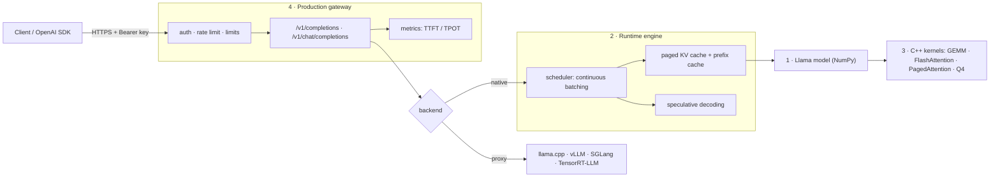

# InferLab — learn inference engineering by building the whole stack

InferLab is a complete, readable LLM serving system. It runs on a laptop CPU and uses **Llama-2-7B**
as the reference model for every calculation. You can read every line, run every experiment, and
watch it work in a live web UI.

It covers the **four layers** of how models are delivered fast, plus scale-out:

| Layer | What you build / study | Code |
|-------|------------------------|------|
| **1 · Foundations** | Llama-2 forward pass (RMSNorm, RoPE, GQA, SwiGLU), BPE tokenizer, sampling, KV cache, quantization (fp16/bf16/int8/Q8_0/Q4_0), memory + FLOP + roofline models | [`inferlab/foundations`](inferlab/foundations) |
| **2 · Runtime** | vLLM-style engine: PagedAttention block manager, continuous batching, chunked prefill, preemption, prefix caching (hash chain + SGLang radix tree), speculative decoding, structured output, async engine | [`inferlab/runtime`](inferlab/runtime) |
| **3 · Kernels** | C++ kernels via ctypes: GEMM ladder (naive → tiled → SIMD → OpenMP), GEMV, Q8_0/Q4_0 integer dot products, FlashAttention, PagedAttention, fused RMSNorm, online softmax, RoPE; plus CUDA and Triton versions | [`csrc`](csrc), [`gpu_kernels`](gpu_kernels) |
| **4 · Production** | OpenAI-compatible gateway (streaming SSE), API-key auth, rate limiting, request limits, Prometheus SLO metrics, hardened Docker/K8s, adapters for **llama.cpp, vLLM, SGLang, TensorRT-LLM** | [`inferlab/server`](inferlab/server), [`deploy`](deploy) |
| **5D parallelism** | Data, tensor (+sequence), pipeline, context (ring / Ulysses) and expert parallelism on a simulated cluster, each proven equal to the single-GPU result; a planner for real GPUs | [`inferlab/parallel`](inferlab/parallel) |



---

## Quick start (5 minutes)

Requirements: Python **3.12+**, a C++17 compiler and CMake (optional, for the kernels). No GPU is needed.

```bash
git clone <this repo> && cd Inference-enginnering-project
make install          # .venv + pinned dependencies + editable package
make kernels          # build + test the C++ kernels (optional but recommended)
make download         # TinyStories Llama-2 15M (61 MB) + the Llama-2 tokenizer -> ./models
make serve            # http://127.0.0.1:8000  (prints where the generated API key was saved)
```

Open **http://127.0.0.1:8000**, paste the API key from `.inferlab_api_key`, and start with
**Overview**. For local-only development without a key, run `make dev`; it binds to 127.0.0.1 only.

Without `make download` the server still runs, using a random-weight tiny Llama. Every mechanism
behaves the same, but the text is noise.

Use it from any OpenAI client:

```python
from openai import OpenAI
client = OpenAI(base_url="http://127.0.0.1:8000/v1", api_key=open(".inferlab_api_key").read().strip())
for chunk in client.completions.create(model="stories15M", prompt="Once upon a time", max_tokens=64, stream=True):
    print(chunk.choices[0].text, end="", flush=True)
```

Or the CLI:

```bash
inferlab generate "Once upon a time" --max-tokens 100            # NumPy engine, prints TTFT / TPOT
inferlab generate "Once upon a time" --no-cache                   # feel the O(n²) without a KV cache
inferlab generate "Once upon a time" --kernels cpp --weight-dtype q8_0
inferlab info --model llama-2-7b --gpu H100-SXM-80GB --batch 32   # memory + roofline for Llama-2-7B
inferlab plan --model llama-2-70b --gpu H100-SXM-80GB --gpus 8 --recommend
inferlab bench attention                                          # naive vs FlashAttention
```

---

## The learning path

Work through these in order. Each step has a doc chapter, a runnable lab script and a UI page.

| # | Topic | Read | Run | UI page |
|---|-------|------|-----|---------|
| 1 | Llama anatomy: where parameters and time go | [01-foundations §1-3](docs/01-foundations.md) | `python labs/01_llama_anatomy.py` | Overview |
| 2 | Tokens, logits, sampling | [01-foundations §4-5](docs/01-foundations.md) | `labs/02_tokens_and_sampling.py` | Tokens & sampling |
| 3 | KV cache: O(n²) → O(n), memory cost | [01-foundations §6](docs/01-foundations.md) | `labs/03_kv_cache.py` | KV cache & quantization |
| 4 | Roofline: memory- vs compute-bound | [01-foundations §7](docs/01-foundations.md) | `labs/04_roofline.py` | Memory & roofline |
| 5 | Quantization | [01-foundations §8](docs/01-foundations.md) | `labs/05_quantization.py` | KV cache & quantization |
| 6 | PagedAttention + continuous batching | [02-runtime §1-4](docs/02-runtime.md) | `labs/06_continuous_batching.py` | Live engine, Batching |
| 7 | Prefix caching (vLLM vs SGLang) | [02-runtime §5](docs/02-runtime.md) | `labs/07_prefix_caching.py` | Batching & prefix cache |
| 8 | Speculative decoding | [02-runtime §6](docs/02-runtime.md) | `labs/08_speculative_decoding.py` | Speculative decoding |
| 9 | Kernels: GEMM, FlashAttention, quantized GEMV | [03-kernels](docs/03-kernels.md) | `labs/09_kernels.py` | Kernels |
| 10 | 5D parallelism | [05-parallelism](docs/05-parallelism.md) | `labs/10_parallelism_5d.py` | 5D parallelism |
| 11 | Production serving | [04-production](docs/04-production.md) | `labs/11_production_server.py` | Playground, Production |
| 12 | Real engines with Llama-2-7B | [06-engines](docs/06-engines.md) | `deploy/engines/*.yml` | Production |
| 13 | Advanced topics | [07-advanced](docs/07-advanced.md) | — | — |

Two cross-cutting references: the [Llama-2-7B case study](docs/08-llama2-7b-case-study.md), which
puts every number for the reference model in one place, and the [glossary](docs/glossary.md).
For a map of the code, read [architecture.md](docs/architecture.md).

---

## Models

| Model | Role | Where it runs |
|-------|------|---------------|
| **Llama-2-7B** (6.74 B params, 32 layers, d=4096, MHA, 4k ctx) | the *reference* model for all math, planning and engine recipes | calculators; the real thing on vLLM / SGLang / TRT-LLM / llama.cpp via `deploy/engines` |
| TinyStories **stories15M / 42M / 110M** | the *live* models: the same Llama-2 architecture and tokenizer, small enough for a CPU | the built-in engine (`make download`) |
| `tiny-random` | offline fallback / tests (GQA 4:2) | the built-in engine |
| Llama-2-13B / 70B, Llama-3-8B, Mixtral-8x7B | contrast cases (GQA, MoE) | calculators + planner |

The built-in engine can also load **Hugging Face safetensors** checkpoints (TinyLlama, Llama-2-7B)
with `INFERLAB_MODEL=/path/to/hf-dir INFERLAB_TOKENIZER=models/tokenizer.bin`. A 7B model in NumPy is
slow (seconds per token), which shows exactly why the kernel and runtime layers exist. Use
`--weight-dtype q4_0` to fit it in about 4 GB.

---

## Configuration

Every setting is an environment variable (see [`inferlab/server/settings.py`](inferlab/server/settings.py)).
These are the most useful:

| Variable | Default | Meaning |
|----------|---------|---------|
| `INFERLAB_HOST` / `INFERLAB_PORT` | `127.0.0.1` / `8000` | bind address (`0.0.0.0` only in containers) |
| `INFERLAB_API_KEYS` / `INFERLAB_API_KEYS_FILE` | generated | comma-separated keys (≥ 16 chars) or a secret file |
| `INFERLAB_MODEL` | `auto` | `auto`, `tiny-random`, a llama2.c `.bin`, or an HF directory |
| `INFERLAB_KERNELS` | `numpy` | `cpp` to use the C++ kernels |
| `INFERLAB_WEIGHT_DTYPE` | `fp32` | `fp16`, `bf16`, `int8`, `q8_0`, `q4_0` |
| `INFERLAB_BACKEND` | `native` | `llamacpp`, `vllm`, `sglang`, `tensorrt_llm` (proxy mode) |
| `INFERLAB_UPSTREAM_URL` | — | engine URL in proxy mode |
| `INFERLAB_NUM_KV_BLOCKS`, `INFERLAB_BLOCK_SIZE`, `INFERLAB_MAX_NUM_SEQS`, `INFERLAB_MAX_BATCHED_TOKENS` | 256, 16, 8, 256 | engine budgets |
| `INFERLAB_RATE_LIMIT_RPS` / `_BURST` | 5 / 20 | token-bucket rate limit per key |
| `INFERLAB_MAX_TOKENS`, `INFERLAB_MAX_PROMPT_CHARS`, `INFERLAB_MAX_BODY_BYTES` | 1024, 32000, 1 MiB | request limits |

## Deploy

```bash
make secret && make download && docker compose up --build          # hardened container on 127.0.0.1:8000
docker compose -f deploy/engines/vllm.yml up                        # Llama-2-7B on vLLM behind the gateway
kubectl apply -f deploy/k8s/inferlab.yaml                           # non-root, read-only FS, NetworkPolicy, HPA
```

## Security

The server is secure by default. It binds to loopback, requires authentication (auth can only be
disabled on loopback), validates every input with hard limits, rate-limits each key, and caps body
size while streaming. It sends a strict CSP and other security headers, never logs prompts or
headers, parses model files as data only (no pickle), and downloads them over HTTPS with SHA-256
checks. The C++ kernels bounds-check and overflow-check their arguments and run under ASan/UBSan in
CI. See [SECURITY.md](SECURITY.md) for the threat model and the full list of controls.

```bash
make check     # ruff + 136 pytest tests + bandit + pip-audit + C++ tests under ASan/UBSan
```

## Repository layout

```
inferlab/
  config.py            model configs (Llama-2-7B/13B/70B, Llama-3-8B, Mixtral, TinyStories)
  foundations/         ops, model, tokenizer, sampling, quantization, weights, perfmodel, generate
  runtime/             block_manager, paged, scheduler, engine, async_engine, speculative,
                       radix_cache, constrained, chat, backends/ (native + OpenAI-compatible engines)
  kernels/             ctypes bindings (cpp.py), NumPy reference algorithms, benchmarks
  parallel/            cluster (collectives), tensor/pipeline/sequence/expert/data parallel, planner
  server/              FastAPI app, OpenAI API, lab API, security, metrics, settings, static UI
  models.py            registry + safe downloads + loading;  cli.py  `inferlab ...`
csrc/                  C++ kernels, CMake, C++ tests (ASan/UBSan) and benchmark
gpu_kernels/           CUDA + Triton versions of the kernels
labs/                  11 runnable lab scripts
docs/                  the course text
benchmarks/            load generator for any OpenAI-compatible endpoint
deploy/                Docker compose for llama.cpp / vLLM / SGLang / TensorRT-LLM, Kubernetes, Prometheus
tests/                 136 tests: correctness of every layer + security behaviour
```

## License

MIT, see [LICENSE](LICENSE). The TinyStories checkpoints and llama2.c tokenizer are by Andrej
Karpathy (MIT). Llama 2 weights are subject to Meta's Llama 2 Community License; accept it on
Hugging Face before downloading them.
