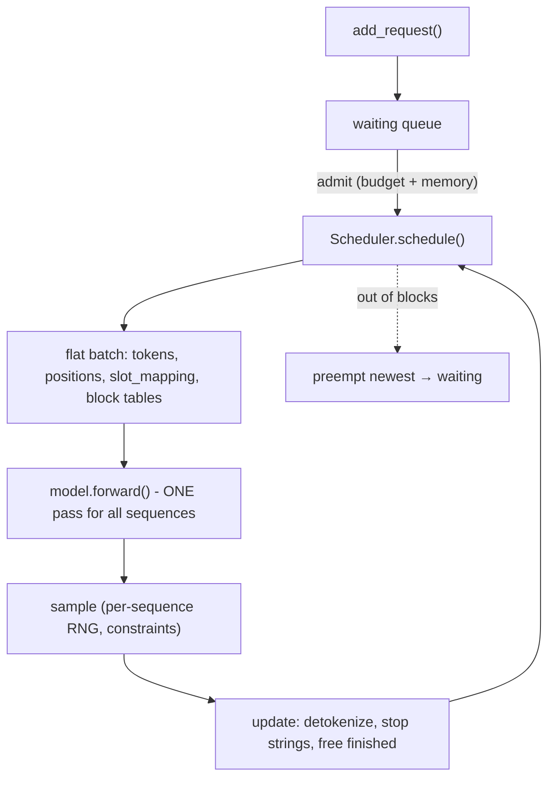

# Layer 2 — Runtime: keeping the hardware busy

> Code: [`inferlab/runtime/`](../inferlab/runtime) · Labs 06–08 · UI: *Live engine*, *Batching &
> prefix cache*, *Speculative decoding*

The foundations layer showed that decode is memory-bound and that the KV cache dominates memory. A
runtime (vLLM, SGLang, TensorRT-LLM's executor, llama.cpp's server) therefore has two jobs:

1. **Batch** as many sequences as possible into each step, so each weight read serves many users.
2. **Manage KV memory** so as many sequences as possible fit at once.

InferLab's engine follows vLLM's design closely, so reading it is a good preparation for reading vLLM.

## 1. The engine step

[`engine.py`](../inferlab/runtime/engine.py) `LLMEngine.step()`:

1. `scheduler.schedule()` picks sequences and how many tokens of each to process.
2. All scheduled tokens are concatenated into **one flat batch** (varlen / ragged batching), so
   there is no padding.
3. One `model.forward()` runs every linear layer as a single `[T, D] × [D, *]` matmul. Only attention
   runs per sequence.
4. One token is sampled for every sequence whose prompt is now fully processed.
5. Text is detokenized incrementally and stop strings are checked (partial matches are held back).
   Finished sequences free their blocks.

The unifying invariant (from vLLM v1): for every sequence, `tokens to compute = num_tokens −
num_computed_tokens`. A new request is all prefill; a decoding request has exactly one uncomputed
token. The scheduler only has to decide how many of these tokens to take.

## 2. PagedAttention ([`block_manager.py`](../inferlab/runtime/block_manager.py), [`paged.py`](../inferlab/runtime/paged.py))

A contiguous cache must reserve `max_len` tokens per request up front. Real requests are much shorter,
so 60–80% of KV memory is wasted (the vLLM paper's measurement). PagedAttention borrows virtual
memory:

- the KV pool is `[layers, num_blocks, block_size, kv_heads, head_dim]`
- each sequence has a **block table**, mapping logical block i to a physical block id
- blocks are allocated on demand as tokens are generated. Waste is less than one block per sequence.
- `slot_mapping[t] = block_table[pos // B] * B + pos % B` tells the kernel where token t's K/V is
  written (vLLM's `reshape_and_cache`)
- the attention kernel follows the block table (see `csrc/src/attention.cpp`
  `il_paged_attention_decode`, which bounds-checks every block id)

Watch it happen on the *Live engine* page: each square is a block, coloured by state.

## 3. Continuous batching ([`scheduler.py`](../inferlab/runtime/scheduler.py))

**Static batching** admits a batch and runs it until *every* sequence finishes, so short requests
wait for the longest one and slots sit idle. **Continuous (iteration-level) batching**, from Orca
(OSDI'22), re-decides the batch at *every step*: finished sequences leave and waiting ones join
immediately. Lab 06 and the *Batching* page run the same workload both ways: continuous needs fewer
steps and gives lower TTFT.

The scheduler works within two budgets:

- `max_num_batched_tokens` (compute per step): bounds step latency, which protects TPOT for
  decoding users
- KV blocks (memory)

Running sequences are scheduled first (decode is latency-critical), then waiting ones are admitted.

## 4. Chunked prefill and preemption

- **Chunked prefill.** A 4k-token prompt would stall every decoding user for a whole step. Instead it
  is split into chunks that fit the token budget and mixed with decode tokens (Sarathi-Serve). The
  *Live engine* chart shows prefill and decode tokens stacked in the same step.
- **Preemption.** When blocks run out, the most recently admitted sequence is evicted: its blocks are
  freed and it is put back at the front of the queue, to be recomputed later (vLLM's "recompute"
  mode; the alternative is swapping KV to CPU memory). Outputs are unaffected. A test forces heavy
  preemption and checks the text is identical.

## 5. Prefix caching

Many requests share prefixes: system prompts, few-shot examples, multi-turn chat history, agent
scaffolds. Recomputing them wastes prefill FLOPs and TTFT.

**vLLM: hashed blocks** ([`block_manager.py`](../inferlab/runtime/block_manager.py)). Every *full*
block gets `hash = H(parent_hash, tokens in block)`, so a hash identifies the whole prefix up to that
block. New requests look up their leading blocks and share them by reference count. Freed blocks keep
their contents and hash until they are evicted in LRU order.

**SGLang: RadixAttention** ([`radix_cache.py`](../inferlab/runtime/radix_cache.py)). A radix tree
whose edges are token runs. Matching is token-granular, branching conversations share structure
naturally, LRU eviction removes leaves, and the scheduler can prioritise requests with long cached
prefixes (cache-aware scheduling).

**Security matters here.** A shared cache is a side channel: a fast TTFT reveals that someone else
sent the same prefix. Early vLLM used Python's `hash()`, and crafted collisions could let one request
read another's cached KV (CVE-2025-25183). InferLab uses SHA-256 and supports a per-tenant
`cache_salt`. Lab 07 shows a salted tenant getting zero hits.

## 6. Speculative decoding ([`speculative.py`](../inferlab/runtime/speculative.py))

Decode is memory-bound, so verifying k+1 tokens in one forward pass costs about the same as
generating one. So:

1. a cheap **drafter** proposes k tokens
2. the target model scores all of them in one pass
3. accept draft token d with probability `min(1, p(d)/q(d))`; at the first rejection, resample from
   `normalize(max(0, p − q))`; if all are accepted, sample a bonus token

This rejection scheme leaves the output distribution **exactly** the target's (Leviathan et al., Chen
et al. 2023). With greedy decoding it reduces to "accept while the draft equals the argmax". Tests
check both properties: exact greedy equality, and an empirical distribution over 30k samples.

| Drafter | Cost | Good when |
|---------|------|-----------|
| n-gram / prompt lookup | free | the output copies the input (summaries, code edits, RAG) |
| small draft model (stories15M for stories110M; Llama-68M for Llama-2-7B) | one small forward per draft token | general text |
| self-speculation (the target's first layers) | no extra weights | quick experiments |
| EAGLE / Medusa / MTP heads | tiny, trained on the target's hidden states | production (vLLM, SGLang, TRT-LLM) |

Speculation helps most at **small batch**. At large batch, decode is already compute-bound and the
extra verification FLOPs are wasted.

## 7. Structured output ([`constrained.py`](../inferlab/runtime/constrained.py))

Before sampling, mask every token that cannot extend the output to a valid string.
`ChoiceConstraint` implements `guided_choice` (try `{"guided_choice": ["yes", "no"]}` on the API).
Production engines compile regexes, JSON schemas and grammars into token-level automata (XGrammar,
Outlines, llguidance) so the mask costs microseconds rather than a vocabulary scan.

## 8. The async front end ([`async_engine.py`](../inferlab/runtime/async_engine.py))

The HTTP server is asyncio; the forward pass is blocking. The engine therefore runs in a background
thread that loops on `step()`, and tokens flow back to each request's `asyncio.Queue` through
`call_soon_threadsafe`. Two production details:

- **Backpressure:** too many requests in flight return HTTP 503 instead of growing the queue without
  bound.
- **Cancellation:** if a client disconnects, its generator is closed and the request is aborted, so
  its KV blocks are freed immediately (a test checks this).

vLLM splits the same loop across processes (API server ↔ engine core over ZeroMQ). SGLang separates
the TokenizerManager, the Scheduler and the Detokenizer.

---

**Exercises**

1. Add a `priority` field to requests and make the scheduler preempt the lowest priority first.
2. Implement swap-based preemption: copy a victim's blocks into a CPU-side pool instead of recomputing.
3. Make the scheduler cache-aware: among waiting requests, admit the one with the longest cached
   prefix first. Measure the hit rate with Lab 07's workload.
4. Speculation inside the batched engine: let `LLMEngine.step()` verify n-gram drafts for decode
   sequences (hint: a decode sequence then has `1 + k` query tokens and needs `all_logits` rows).
