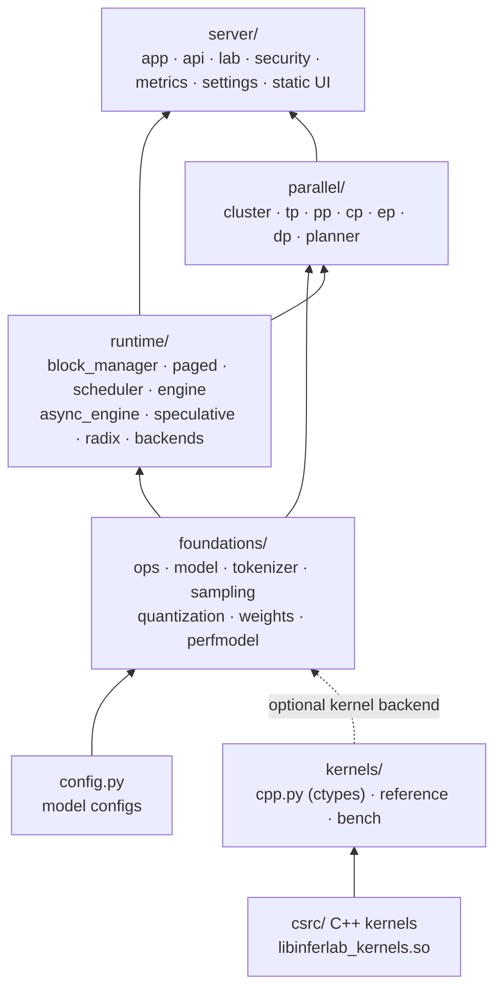
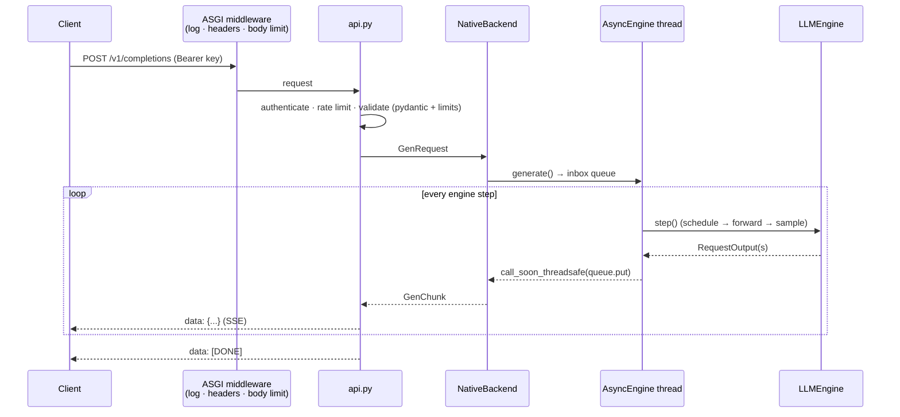

# Architecture and code map

## Package dependency graph



Lower layers never import higher ones. `LlamaModel` takes an optional kernel backend object, and
the runtime provides the KV storage through a `ForwardContext`. That is the same separation vLLM uses
between model code and attention backends.

## The key interface: `ForwardContext`

```python
class ForwardContext(Protocol):
    positions: np.ndarray                 # [T] absolute positions of the tokens in this batch
    logit_indices: np.ndarray | None      # rows that need logits
    def attend(self, layer, q, k, v): ... # store K/V, return attention output
    def finish(self): ...
```

| Implementation | Where | Used by |
|----------------|-------|---------|
| `_ContiguousContext` (via `KVCache.context`) | `foundations/model.py` | `generate()`, speculative decoding, labs |
| `PagedForwardContext` | `runtime/paged.py` | `LLMEngine` (batched, block tables, slot mapping) |
| ad-hoc stage loop | `parallel/pipeline_parallel.py` | pipeline simulation |

The model code is identical in all three cases; only the KV layout changes.

## Request path through the server



## Where to look first

| If you want to understand… | Start at |
|----------------------------|----------|
| the transformer maths | `foundations/model.py` → `LlamaModel.forward` |
| why decode is slow | `foundations/perfmodel.py` → `decode_step` |
| PagedAttention | `runtime/block_manager.py` → `allocate_slots`, then `runtime/paged.py` → `PagedForwardContext.attend` |
| continuous batching | `runtime/scheduler.py` → `Scheduler.schedule` |
| one engine iteration | `runtime/engine.py` → `LLMEngine.step` |
| speculative decoding | `runtime/speculative.py` → `verify_draft`, `speculative_generate` |
| FlashAttention | `kernels/reference.py` → `flash_attention` (Python), then `csrc/src/attention.cpp` |
| quantized GEMV | `foundations/quantization.py` (formats), then `csrc/src/quant.cpp` (AVX2) |
| tensor parallelism | `parallel/tensor_parallel.py` → `tp_forward` |
| the HTTP API and its security | `server/app.py` → `create_app`, `server/security.py`, `server/api.py` |

## Tests as documentation

`tests/` is organised by layer, and most tests state an invariant worth knowing:

- `test_engine_matches_single_sequence_reference`: batching, paging, chunking and preemption never
  change greedy output
- `test_kv_cache_matches_full_recompute`: the cache is an optimisation, not an approximation
- `test_speculative_greedy_is_exact`, `test_rejection_sampling_preserves_distribution`
- `test_tensor_parallel_exact`, `test_ring_attention_exact`, `test_expert_parallel_exact_and_capacity`
- `test_hf_roundtrip_and_rope_permutation`: interleaved vs half RoPE are the same model after a
  permutation
- `test_cpp_paged_attention_rejects_bad_block_ids`, `test_safetensors_validation`,
  `test_hf_index_path_traversal_rejected`, `test_validation_errors_do_not_echo_input`,
  `test_no_inline_script_in_ui`: the security behaviour
